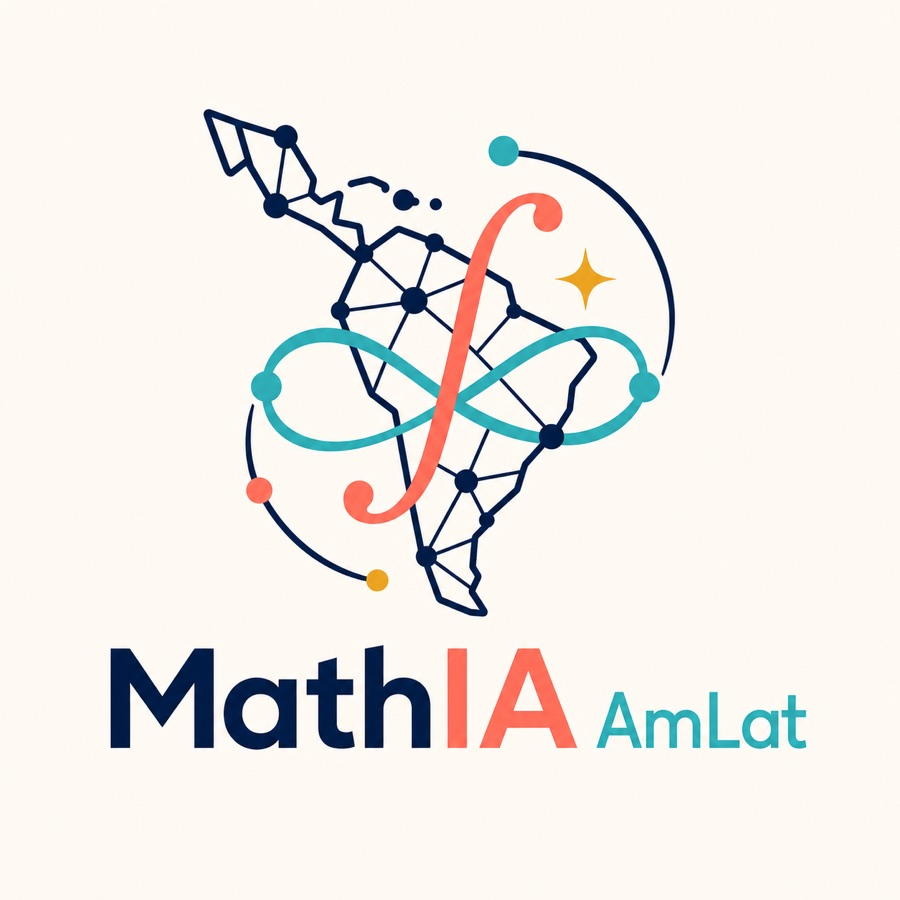

I’m a Ph.D. candidate in Mathematics at the [Institute of Mathematics, Statistics and Scientific Computing (IMECC)](https://www.ime.unicamp.br/en), [University of Campinas (UNICAMP)](https://www.unicamp.br/en), supervised by [Prof. Dr. Henrique N. Sá Earp](https://www.ime.unicamp.br/~hqsaearp/).

My work sits at the intersection of **geometry and computation**: I develop and apply **machine learning / AI** methods to problems in **Complex Differential Geometry** and **Algebraic Geometry**, aiming to turn geometric structure into practical numerical pipelines and new mathematical insight.

Before moving into mathematics, I completed a B.Sc. in Computer Engineering at UNICAMP (2021) and worked as a junior researcher at the [Security and Cryptography Laboratory (LASCA)](https://www.lasca.ic.unicamp.br/) within the [Institute of Computing (IC)](https://ic.unicamp.br/en/), focusing on cryptanalysis of post-quantum and modern cryptographic systems.

## GeometrIA Lab

I am a co-founder and member of [**GeometrIA**](https://www.cbg.ime.unicamp.br/GeometrIALab/), the AI and Geometry Laboratory of the [Brazilian Center for Geometry (CBG)](https://www.cbg.ime.unicamp.br/) — a FAPESP CEPID hosted at IMECC/UNICAMP. The lab brings machine learning to bear on geometric problems along four lines: **approximating** geometric objects with neural networks, **predicting** invariants from data to formulate conjectures, **searching** for rare objects in large combinatorial spaces, and **assisting** mathematical research with AI tools.

## MathIA AmLat

I founded and run [**MathIA AmLat**](https://math-ia-amlat.zulipchat.com/), a Zulip organization dedicated to discussions on **AI for Mathematics in Latin America**. It is a space for researchers and students across the region to share work, questions, and ideas at the meeting point of machine learning and mathematical research.

  

The community is open to anyone interested in the area. If you would like to join, please [email me](mailto:tomas@ime.unicamp.br) requesting access.

MathIA AmLat is generously sponsored by  [**Zulip**](https://zulip.com/) — an organized team chat app designed for efficient communication.

 
 
 
 
 
 
 
 

